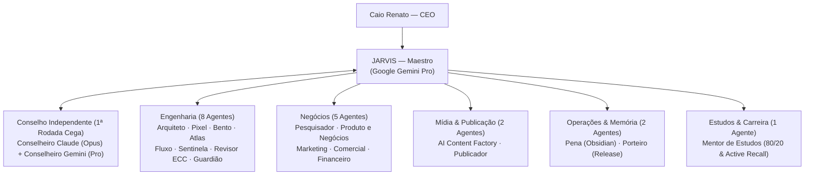

# 🏛️ JARVIS Agent Company — Arquitetura Multiagente Multi-Família (`GPT · Gemini · Claude`)

> **Blueprint arquitetural, manifesto de 21 agentes, 8 Core Skills modulares, estudo ativo 80/20, stack de economia de tokens (MCPs/plugins) e governança SQLite *Fail-Closed* para equipes de agentes de IA.**

[](LICENSE)
[](agents/roster.json)
[](#arquitetura)
[](#estrutura-e-skills)
[](sql/schema-missoes.sql)

---

<a id="english-tldr"></a>
## English Summary (TL;DR)

**JARVIS Agent Company** is a practical multi-agent orchestration architecture designed for Software & AI Engineers who want **cross-model checks and balances** instead of a single monolithic prompt:
- **21 permanent agents across 7 departments** (`Direction`, `Independent Council`, `Engineering`, `Business`, `Media`, `Operations`, and `Active Study 80/20`).
- **Multi-family routing (`7 OpenAI GPT/Codex · 8 Google Gemini · 6 Anthropic Claude`):** code written by GPT specialists is reviewed by Claude auditors (`Revisor ECC` & `Guardião`) to mitigate *self-preference bias* (Wataoka et al., 2024; Panickssery et al., 2024).
- **Blind Independent Council (`Fail-Closed`):** critical decisions go simultaneously to two distinct model families in a blind 1st round; an SQL view (`v_validacao_conselho`) marks any round with fewer than 2 distinct families as `CONSELHO INCOMPLETO`.
- **Actionable deliverables included:** [`agents/roster.json`](agents/roster.json), [`scripts/install.ps1`](scripts/install.ps1) / [`scripts/install.sh`](scripts/install.sh), [`sql/schema-missoes.sql`](sql/schema-missoes.sql), [`bench/measure_repo.py`](bench/measure_repo.py), and an anonymized blind-council case study in [`examples/case-study-login-ratelimit/`](examples/case-study-login-ratelimit/).

> **Suggested GitHub Topics:** `multi-agent-systems` · `ai-agents` · `llm-orchestration` · `claude-code` · `gemini` · `codex` · `sqlite` · `obsidian`

---

<a id="arquitetura"></a>
## 1. Visão Geral da Arquitetura

Sistemas com agentes de IA costumam perder confiabilidade em projetos reais por três falhas estruturais:
1. **Monocultura de modelo (*Self-Preference Bias*):** quando o mesmo modelo planeja, escreve o código e aprova a revisão, ele tende a favorecer seu próprio estilo e repetir pontos cegos.
2. **Explosão de contexto:** carregar prompts gigantescos e logs brutos em um único agente degrada atenção e desperdiça cota.
3. **Estado operacional ilusório:** confundir um agente disponível (`ready`) com uma missão concluída e validada.

A **JARVIS Agent Company (v2.2)** resolve esses três problemas com **21 agentes permanentes em 7 departamentos**, coordenados por um único ponto de entrada (**`JARVIS — Maestro`**):



---

<a id="multi-familia"></a>
## 2. Roteamento Multi-Família e Revisão Cruzada (`7 GPT · 8 Gemini · 6 Claude`)

Em vez de concentrar tudo em um provedor, cada agente é alocado à família mais aderente ao seu tipo de tarefa, com **revisão cruzada obrigatória** na engenharia:

- **Construção de Backend, SQL, Integrações e Testes (`Arquiteto`, `Bento`, `Atlas`, `Fluxo`, `Sentinela`):** família **OpenAI GPT / Codex**.
- **Auditoria Cruzada de Código e Segurança (`Revisor ECC` e `Guardião`):** família **Anthropic Claude (Sonnet)** — quem audita Backend, SQL e Automações pertence a uma família de pesos diferente de quem implementou.
- **Frontend (`Pixel`):** família **Anthropic Claude (Sonnet)** — para alterações críticas de UI ou segurança client-side que exijam independência de família, o Maestro aciona `Sentinela` (`GPT/Codex`) ou o `Conselho Independente` (`Claude` × `Gemini`).
- **Orquestração Long-Context, Pesquisa, Copywriting, Memória e Ensino 80/20 (`JARVIS`, `Pesquisador`, `Marketing`, `Comercial`, `Publicador`, `Pena`, `Mentor de Estudos`):** família **Google Gemini (Pro / Flash)**.

> **Nota sobre tiers de modelos:** Na tabela abaixo e em [`agents/roster.json`](agents/roster.json), os modelos são listados por **família pública + tier de capacidade** (*ex.: Opus, Sonnet, Pro, Flash, GPT/Codex*), permitindo mapear diretamente para o catálogo atual do seu provedor sem depender de *aliases* internos de runtime.

---

<a id="agentes"></a>
## 3. Quadro Completo dos 21 Agentes Permanentes

| # | Departamento | Agente | Família / Tier Público | Papéis Consolidados | Responsabilidade e Limite de Escrita |
|---|---|---|---|---|---|
| 1 | **Direção** | **JARVIS (Maestro)** | Google Gemini (`Pro`) | `maestro` | Ponto de entrada do CEO; delega por pacote de 5 itens, limita retrabalho a 2 ciclos e sintetiza evidências. |
| 2 | **Conselho** | **Conselheiro Claude** | Anthropic Claude (`Opus`) | Conselho Independente | 1º parecer cego independente sobre arquitetura, segurança e contratos. Somente leitura. |
| 3 | **Conselho** | **Conselheiro Gemini** | Google Gemini (`Pro`) | Conselho Independente | 2º parecer cego independente de família distinta para expor riscos exclusivos. Somente leitura. |
| 4 | **Engenharia** | **Arquiteto** | OpenAI GPT / Codex (`Systems`) | `planner` + `architect` | Converte requisitos em plano verificável, dependências por arquivo e critérios de aceite. |
| 5 | **Engenharia** | **Pixel** | Anthropic Claude (`Sonnet`) | `pixel` + `a11y-architect` + `react-build-resolver` | Exclusivo Frontend: React/Vite/PWA, CSS, responsividade e acessibilidade. |
| 6 | **Engenharia** | **Bento** | OpenAI GPT / Codex (`Coding`) | `bento` + `build-error-resolver` + `refactor-cleaner` + `performance-optimizer` | Exclusivo Backend: Python/Flask/FastAPI, regras de negócio, auth JWT e build. |
| 7 | **Engenharia** | **Atlas** | OpenAI GPT / Codex (`Structured Data`) | `atlas` | Exclusivo Dados: modelagem PostgreSQL/SQLite, índices, RLS e migrações com rollback. |
| 8 | **Engenharia** | **Fluxo** | OpenAI GPT / Codex (`Coding`) | `agente-automacao` | Exclusivo Automações: workflows, webhooks com idempotência, timeout e retry. |
| 9 | **Engenharia** | **Sentinela** | OpenAI GPT / Codex (`Testing`) | `sentinela` + `tdd-guide` + `e2e-runner` | Execução de testes unitários, integração e jornadas E2E. |
| 10 | **Engenharia** | **Revisor ECC** | Anthropic Claude (`Sonnet`) | `code/python/fastapi/ts/react/database-reviewer` + `silent-failure-hunter` | Revisão cruzada multistack e caça a falhas silenciosas (arquivo, linha e correção). |
| 11 | **Engenharia** | **Guardião** | Anthropic Claude (`Sonnet`) | `security-reviewer` + `dir-seguranca` | Auditoria defensiva cruzada (AppSec): segredos, auth, permissões e validação. |
| 12 | **Negócios** | **Pesquisador** | Google Gemini (`Flash`) | `pesquisador` + `docs-lookup` | Fontes primárias e documentação oficial; separa fatos, inferências e lacunas. |
| 13 | **Negócios** | **Produto e Negócios** | Anthropic Claude (`Sonnet`) | `dir-negocios` | Requisitos de produto (PRD), hipóteses de valor e priorização de escopo. |
| 14 | **Negócios** | **Marketing** | Google Gemini (`Pro`) | `dir-marketing` + `copywriter` + `trafego` | Posicionamento, copy e plano de tráfego (sem publicar nem contratar mídia). |
| 15 | **Negócios** | **Comercial** | Google Gemini (`Pro`) | `dir-vendas` + `closer` | Propostas comerciais e scripts de abordagem (nunca envia mensagens sem o CEO). |
| 16 | **Negócios** | **Financeiro** | OpenAI GPT / Codex (`Quantitative`) | `financeiro` | Modelagem de custos, precificação, margem, ROI e orçamento (sem pagamentos). |
| 17 | **Mídia** | **AI Content Factory** | Anthropic Claude (`Opus`) | `pipeline-3d-orchestrator` | Orquestração local de vídeo 3D narrado (GPU local, ex.: RTX 3060, TTS e mixagem). |
| 18 | **Mídia** | **Publicador** | Google Gemini (`Flash`) | `publicador-multi-rede` | Metadados e agendamento em nuvem multi-rede sempre com confirmação do CEO. |
| 19 | **Operações** | **Pena** | Google Gemini (`Flash`) | `pena` + `doc-updater` | Registro auditável no Obsidian (`00-INDICE` a `05-TESTES`) com *read-back* obrigatório. |
| 20 | **Operações** | **Porteiro** | OpenAI GPT / Codex (`Fast CLI`) | `porteiro` | Checks finais de repositório, diffs e pacotes de release (sem `push`/deploy sem CEO). |
| 21 | **Estudos** | **Mentor de Estudos** | Google Gemini (`Pro`) | `mentor-engenharia-ia` + `curador-80-20` | Revisa tarefas de código como mentor, extrai os 20% essenciais de vídeos longos (80/20) e cria perguntas de verificação ativa e exercícios. |

---

<a id="comparativos"></a>
## 4. Comparativo Técnico e Evidências Reproduzíveis

### 4.1 O que este Repositório Entrega vs. Integrações Externas do Ambiente

Para transparência técnica, a tabela abaixo separa exatamente o que está **neste repositório** do que pertence a **ferramentas externas opcionais**:

| Capacidade | Agente Único | Skill de Conselho (CLI) | JARVIS Agent Company (Neste Repo) | Camada de Runtime / MCP Externa (Opcional) |
|---|:---:|:---:|:---:|:---|
| Pacote formal de delegação em 5 itens + limite de 2 ciclos | — | — | ✓ (`orquestracao-maestro-ecc`) | Orquestrador (`OpenBot`, `Claude Code`, `Cursor`) |
| Manifesto de 21 papéis com isolamento por camada | — | — | ✓ (`agents/roster.json`) | Perfis configurados no runtime escolhido |
| Revisão cruzada no Backend/SQL/Automações (família que audita ≠ família que codifica) | — | — | ✓ (`Revisor ECC`, `Guardião`) | Provedores `GPT` + `Claude` + `Gemini` |
| Conselho cego + regra *Fail-Closed* (`CONSELHO INCOMPLETO`) | — | ✓ *(sem SQL view)* | ✓ (`sql/schema-missoes.sql`) | `Conselheiro Claude` + `Conselheiro Gemini` |
| Controle de estado de missões (`FK`, `CHECK`, índices) | — | — | ✓ (`scripts/init_db.py`) | SQLite local (`data/missoes.db`) |
| Ensino ativo 80/20 (vídeos longos + *Active Recall*) | — | — | ✓ (`mentor-estudo-80-20`) | `yt-dlp` (opcional para legendas de vídeo) |
| Economia de contexto via Sandbox FTS5/BM25, diffs mínimos e Grafo de Código | — | — | ✓ *(templates & guia em `configs/` e `docs/`)* | `Context Mode` MCP + `Ponytail` + `Graphify` |
| Memória seletiva e auditável com *read-back* | — | — | ✓ (`obsidian-triagem` + `memoria-auditavel-obsidian-pena`) | Cofre Markdown + `Obsidian MCP` |

### 4.2 Métricas Reproduzíveis vs. Observações de Implantação

- **Verificações reproduzíveis localmente neste repositório (`python bench/measure_repo.py`):**
  - `21` agentes validados em `7` departamentos (`7 OpenAI GPT/Codex · 8 Google Gemini · 6 Anthropic Claude`);
  - `8` *Core Skills* válidas em `kebab-case` (validadas dinamicamente com nome de pasta idêntico ao `name:` do frontmatter);
  - Validação automática da view SQL `v_validacao_conselho`: retorna `CONSELHO INCOMPLETO` quando há apenas 1 parecer e `REPROVA` quando as 2 famílias respondem no caso piloto;
  - `CHECK constraint` validada bloqueando vereditos inválidos via `sqlite3.IntegrityError`.
- **Observações de uso no ambiente de produção local (não generalizadas como benchmark universal):**
  - Consolidação de `55` definições anteriores de prompts/subagentes (`34` globais ECC + `7` variantes locais + `14` subagentes de vídeo 3D) em `21` papéis permanentes com carregamento sob demanda via skills.
  - Em leituras de árvore de interface via `cua-driver`, consultas filtradas por `query`/`since` reduziram leituras completas de ~42 KB para ~2 KB na observação local do driver.

---

<a id="estudo-caso"></a>
## 5. Estudo de Caso Real: Conselho Independente Cego (`Claude` × `Gemini`)

Todos os artefatos deste estudo de caso estão em [`examples/case-study-login-ratelimit/`](examples/case-study-login-ratelimit/):
- [`prompt-rodada-cega.md`](examples/case-study-login-ratelimit/prompt-rodada-cega.md) — pacote enviado sem revelar preferência do Maestro;
- [`parecer-claude.md`](examples/case-study-login-ratelimit/parecer-claude.md) e [`parecer-gemini.md`](examples/case-study-login-ratelimit/parecer-gemini.md) — pareceres independentes anonimizados;
- [`seed-case-study.sql`](examples/case-study-login-ratelimit/seed-case-study.sql) — seed SQLite que demonstra tanto o bloqueio `CONSELHO INCOMPLETO` (1 parecer) quanto a convergência `REPROVA` (2 famílias).

**Resumo do caso (proposta de elevar o limite de tentativas de login de 5 para 10):**
- **Convergência (`REPROVA`):** ambas as famílias apontaram ausência de escopo do contador (IP vs. conta), janela temporal, política de bloqueio, controles compensatórios (*backoff*/CAPTCHA) e logs/alertas.
- **Complementos exclusivos:** a família **Claude** cobrou verificação de senhas vazadas (*HIBP*), MFA obrigatório para administradores e testes automatizados; a família **Gemini** destacou o risco de **Account Lockout DoS** (travamento malicioso de contas alheias) sem fluxo seguro de desbloqueio.

---

<a id="quickstart"></a>
## 6. Quickstart & Portabilidade (OpenBot, Claude Code, Cursor, Antigravity)

### Pré-requisitos
- **Python 3.9+** (necessário para `scripts/init_db.py`, `bench/measure_repo.py` e `extrair_transcricao.py`).
- **`yt-dlp`** (opcional, exigido apenas no fluxo 6.3 para extrair legendas públicas de vídeos).
- **Nota sobre SQLite (`PRAGMA foreign_keys`):** o SQLite ativa chaves estrangeiras por conexão; `scripts/init_db.py` já aplica `PRAGMA foreign_keys = ON;`, mas ao abrir `data/missoes.db` em clientes externos (`sqlite3`, DBeaver, DB Browser), execute `PRAGMA foreign_keys = ON;` na sessão.

### 6.1 Inicializar o banco SQLite e validar o Conselho *Fail-Closed*
```bash
python scripts/init_db.py --db data/missoes.db --seed
python bench/measure_repo.py
```
*(A execução padrão é idempotente e preserva missões já existentes; passe `--reset` apenas se quiser apagar e recriar o arquivo `.db`).*

### 6.2 Instalar as 8 Core Skills localmente
- **Windows (PowerShell):**
  ```powershell
  powershell -ExecutionPolicy Bypass -File scripts/install.ps1
  ```
- **Linux / macOS (Bash):**
  ```bash
  bash scripts/install.sh
  ```
  *(Por padrão instala em `~/.claude/skills` preservando pastas existentes; passe `-TargetDir <pasta>` / `-Force` no PowerShell, ou `<pasta>` / `--force` no Bash).*

### 6.3 Fluxo de Estudo 80/20 para Vídeos Longos (`Mentor de Estudos`)
```bash
python skills/mentor-estudo-80-20/scripts/extrair_transcricao.py "https://www.youtube.com/watch?v=SEU_VIDEO"
```
Depois, envie a transcrição (ou seu código/tarefa) ao agente **`Mentor de Estudos`** para receber os **20% essenciais**, **perguntas de verificação ativa** e **exercícios práticos**.

### 6.4 Stack de Economia Máxima de Tokens (Plugins & MCPs)
Para manter tarefas longas dentro da janela de cota (ex.: limite de 5 horas), consulte [`docs/stack-plugins-mcps-economia.md`](docs/stack-plugins-mcps-economia.md) e os templates sanitizados em:
- [`configs/mcp-servers.example.json`](configs/mcp-servers.example.json) — matriz de MCPs por agente (`Context Mode`, `Obsidian`, `Context7`, `GitHub`, isolando `Vercel` e `ElevenLabs` apenas onde são usados);
- [`configs/claude-settings.economy.example.json`](configs/claude-settings.economy.example.json) — perfil econômico para Claude Code (`autoCompactWindow: 150000`, `effortLevel: "medium"`, plugins enxutos).

---

<a id="estrutura-e-skills"></a>
## 7. Estrutura do Repositório

```text
agent-company/
├── AGENTS.md                                              # Instruções permanentes do JARVIS — Maestro
├── LICENSE                                                # Licença MIT
├── README.md                                              # Documentação, comparativos e quickstart
├── THIRD_PARTY_NOTICES.md                                 # Atribuições (ECC, Conselho, Context Mode, Ponytail, etc.)
├── agents/
│   ├── roster.json                                        # Manifesto dos 21 agentes em 7 departamentos
│   └── prompts-especialistas.md                           # Briefings reutilizáveis dos 21 papéis
├── bench/
│   └── measure_repo.py                                    # Auditoria reproduzível de skills, roster e SQLite
├── configs/
│   ├── claude-settings.economy.example.json               # Perfil econômico para Claude Code (janela 5h)
│   └── mcp-servers.example.json                           # Templates sanitizados de MCPs por departamento
├── docs/
│   └── stack-plugins-mcps-economia.md                     # Guia completo de economia de tokens, plugins e MCPs
├── examples/
│   └── case-study-login-ratelimit/                        # Estudo de caso completo + seed Fail-Closed
├── scripts/
│   ├── init_db.py                                         # Inicializador e verificador SQLite
│   ├── install.ps1                                        # Instalador Windows (8 Core Skills)
│   └── install.sh                                         # Instalador Linux/macOS (8 Core Skills)
├── sql/
│   └── schema-missoes.sql                                 # Schema com FK, CHECK, índices e VIEW v_validacao_conselho
└── skills/
    ├── orquestracao-maestro-ecc/SKILL.md
    ├── conselho-independente-dupla-familia/SKILL.md
    ├── padroes-de-engenharia-ecc/SKILL.md
    ├── revisao-independente-ecc-multistack/SKILL.md
    ├── memoria-auditavel-obsidian-pena/SKILL.md
    ├── obsidian-triagem/SKILL.md
    ├── negocios-pesquisa-e-operacoes-ecc/SKILL.md
    └── mentor-estudo-80-20/
        ├── SKILL.md
        └── scripts/extrair_transcricao.py
```

---

## 8. Créditos e Referências
- **Autor e Arquiteto:** [Caio Renato (`@CaioRen4to`)](https://github.com/CaioRen4to)
- **Licenças e Projetos Base:** consulte [`THIRD_PARTY_NOTICES.md`](THIRD_PARTY_NOTICES.md) para atribuições completas ao **ECC (*Everything Claude Code*)** e a [`gabrielcoutinhoDL/claude-skill-conselho-dos-ancioes`](https://github.com/gabrielcoutinhoDL/claude-skill-conselho-dos-ancioes).
- **Literatura sobre *Self-Preference Bias* em LLMs:** Wataoka et al. (2024), *"Self-Preference Bias in LLM-as-a-Judge"*; Panickssery et al. (2024), *"LLM Evaluators Recognize and Favor Their Own Generations"*.
