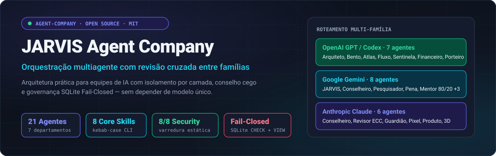
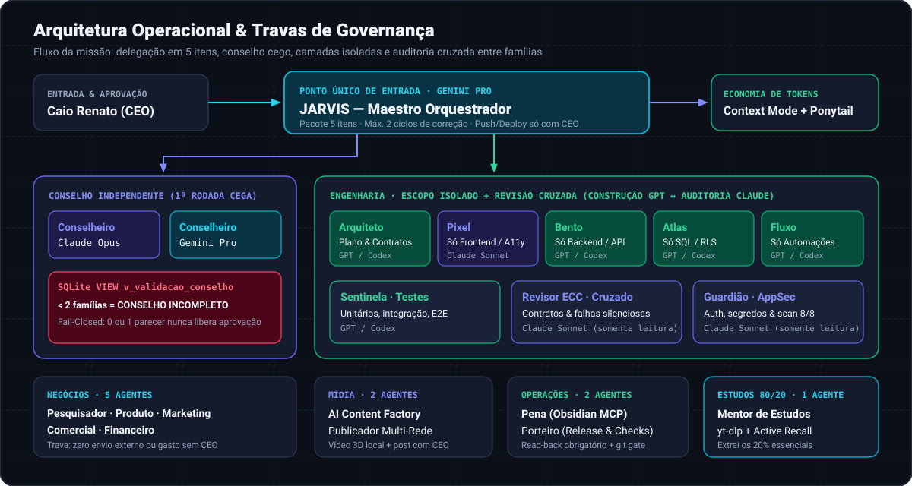
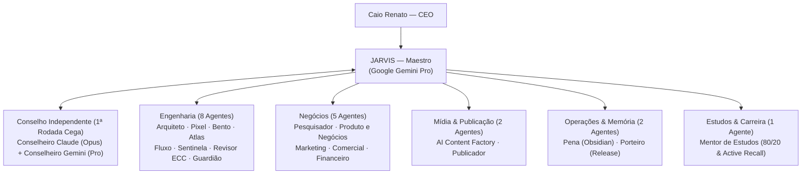
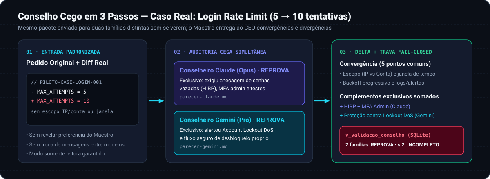
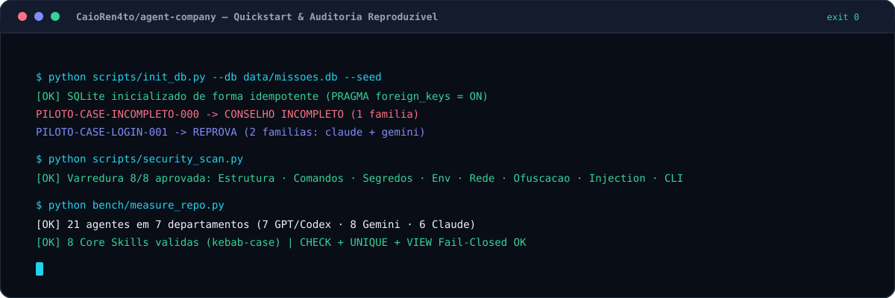

<a id="top"></a>

<p align="center">
  <picture>
    <source media="(prefers-color-scheme: dark)" srcset="assets/hero-dark.svg">
    <source media="(prefers-color-scheme: light)" srcset="assets/hero-light.svg">
    
  </picture>
</p>

<p align="center">
  <a href="https://github.com/CaioRen4to/agent-company/actions/workflows/verify.yml"></a>
  <a href="LICENSE"></a>
  <a href="agents/roster.json"></a>
  <a href="#estrutura-e-skills"></a>
  <a href="scripts/security_scan.py"></a>
  <a href="sql/schema-missoes.sql"></a>
  <a href="https://caioren4to.github.io/agent-company/"></a>
</p>

<p align="center">
  <a href="#english-tldr">English TL;DR</a> ·
  <a href="#arquitetura">Arquitetura</a> ·
  <a href="#estudo-caso">Conselho Cego</a> ·
  <a href="#agentes">21 Agentes</a> ·
  <a href="#seguranca-e-bench">Segurança 8/8 &amp; Bench</a> ·
  <a href="#comparativos">Comparativo</a> ·
  <a href="#quickstart">Quickstart</a> ·
  <a href="https://caioren4to.github.io/agent-company/">Portal Web</a>
</p>

---

<a id="english-tldr"></a>
## English Summary (TL;DR)

**JARVIS Agent Company** is a practical multi-agent orchestration architecture designed for Software & AI Engineers who want **cross-model checks and balances** instead of a single monolithic prompt:
- **21 permanent agents across 7 departments** (`Direction`, `Independent Council`, `Engineering`, `Business`, `Media`, `Operations`, and `Active Study 80/20`).
- **Multi-family routing (`7 OpenAI GPT/Codex · 8 Google Gemini · 6 Anthropic Claude`):** code written by GPT specialists is reviewed by Claude auditors (`Revisor ECC` & `Guardião`) to mitigate *self-preference bias* (Wataoka et al., 2024; Panickssery et al., 2024).
- **Blind Independent Council (`Fail-Closed`):** critical decisions go simultaneously to two distinct model families (`original request + real diff`) in a blind 1st round; an SQL view (`v_validacao_conselho`) marks any round with fewer than 2 distinct families as `CONSELHO INCOMPLETO`.
- **8-Point Static Security Scan & Reproducible Benchmark:** automated CLI checks in [`scripts/security_scan.py`](scripts/security_scan.py) and [`bench/measure_repo.py`](bench/measure_repo.py) run locally and on GitHub Actions CI before installing any skill.
- **Interactive Portal (GitHub Pages):** filter all 21 agents, simulate the `Fail-Closed` SQLite rule, and copy quickstart commands in [`docs/index.html`](docs/index.html).

> **Suggested GitHub Topics:** `multi-agent-systems` · `ai-agents` · `llm-orchestration` · `claude-code` · `gemini` · `codex` · `sqlite` · `obsidian`

---

<a id="arquitetura"></a>
## 1. Visão Geral da Arquitetura

Sistemas com agentes de IA costumam perder confiabilidade em projetos reais por três falhas estruturais:
1. **Monocultura de modelo (*Self-Preference Bias*):** quando o mesmo modelo planeja, escreve o código e aprova a revisão, ele tende a favorecer seu próprio estilo e repetir pontos cegos.
2. **Explosão de contexto:** carregar prompts gigantescos e logs brutos em um único agente degrada atenção e estoura cotas (como a janela de 5 horas).
3. **Estado operacional ilusório:** confundir um agente disponível (`ready`) com uma missão concluída e validada.

<p align="center">
  <picture>
    <source media="(prefers-color-scheme: dark)" srcset="assets/architecture-dark.svg">
    <source media="(prefers-color-scheme: light)" srcset="assets/architecture-light.svg">
    
  </picture>
</p>

> [!IMPORTANT]
> **Trava *Fail-Closed* e Escopo Isolado:** nenhuma camada edita arquivos fora do seu domínio (`Pixel` = Frontend, `Bento` = Backend, `Atlas` = SQL/Dados, `Fluxo` = Automações), ciclos de correção são limitados a **2 rodadas**, e decisões críticas exigem **2 famílias distintas** na view SQLite `v_validacao_conselho` — com 0 ou 1 parecer, o status permanece **`CONSELHO INCOMPLETO`**.

<details>
<summary><b>Ver diagrama Mermaid em texto (alternativa acessível para leitores/parsers)</b></summary>



</details>

---

<a id="multi-familia"></a>
## 2. Roteamento Multi-Família e Revisão Cruzada (`7 GPT · 8 Gemini · 6 Claude`)

Em vez de concentrar tudo em um provedor, cada agente é alocado à família mais aderente ao seu tipo de tarefa, com **revisão cruzada obrigatória** na engenharia:

- **Construção de Backend, SQL, Integrações e Testes (`Arquiteto`, `Bento`, `Atlas`, `Fluxo`, `Sentinela`):** família **OpenAI GPT / Codex**.
- **Auditoria Cruzada de Código e Segurança (`Revisor ECC` e `Guardião`):** família **Anthropic Claude (Sonnet)** — quem audita Backend, SQL e Automações pertence a uma família de pesos diferente de quem implementou.
- **Frontend (`Pixel`):** família **Anthropic Claude (Sonnet)** — para alterações críticas de UI ou segurança *client-side* que exijam independência de família, o Maestro aciona `Sentinela` (`GPT/Codex`) ou o `Conselho Independente` (`Claude` × `Gemini`).
- **Orquestração Long-Context, Pesquisa, Copywriting, Memória e Ensino 80/20 (`JARVIS`, `Pesquisador`, `Marketing`, `Comercial`, `Publicador`, `Pena`, `Mentor de Estudos`):** família **Google Gemini (Pro / Flash)**.

> [!TIP]
> **Economia máxima de tokens (janela de 5h):** use o guia [`docs/stack-plugins-mcps-economia.md`](docs/stack-plugins-mcps-economia.md) e os perfis em [`configs/`](configs/) para combinar `Context Mode` (FTS5/BM25 em sandbox), `Ponytail` (diffs mínimos), `Graphify` (grafo de código) e `obsidian-triagem` (leitura seletiva sem despejar o cofre inteiro).

---

<a id="agentes"></a>
## 3. Quadro Completo dos 21 Agentes Permanentes

| Departamento | Qtd | Agentes | Famílias Dominantes | Escopo de Escrita |
|---|---:|---|---|---|
| **Direção** | 1 | `JARVIS (Maestro)` | Gemini (`Pro`) | Coordenação por pacote de 5 itens, máx. 2 ciclos e síntese ao CEO |
| **Conselho** | 2 | `Conselheiro Claude`, `Conselheiro Gemini` | Claude (`Opus`) × Gemini (`Pro`) | Somente leitura — pareceres cegos sobre pedido original + `diff` real |
| **Engenharia** | 8 | `Arquiteto`, `Pixel`, `Bento`, `Atlas`, `Fluxo`, `Sentinela`, `Revisor ECC`, `Guardião` | GPT/Codex (5) + Claude (3) | Isolado por camada + revisão cruzada e AppSec |
| **Negócios** | 5 | `Pesquisador`, `Produto e Negócios`, `Marketing`, `Comercial`, `Financeiro` | Gemini (3) + Claude (1) + GPT (1) | PRD, pesquisa, rascunhos e ROI (zero envio externo ou gasto sem CEO) |
| **Mídia** | 2 | `AI Content Factory`, `Publicador` | Claude (`Opus`) + Gemini (`Flash`) | Vídeo 3D local + publicação somente com aprovação do CEO |
| **Operações** | 2 | `Pena`, `Porteiro` | Gemini (`Flash`) + GPT (`Fast CLI`) | Memória Obsidian com *read-back* + checks finais de release |
| **Estudos** | 1 | `Mentor de Estudos` | Gemini (`Pro`) | Revisão didática, síntese 80/20 de vídeos longos e *Active Recall* |

<details>
<summary><b>Abrir tabela detalhada dos 21 agentes (papéis consolidados, tiers públicos e limites)</b></summary>

| # | Departamento | Agente | Família / Tier Público | Papéis Consolidados | Responsabilidade e Limite de Escrita |
|---|---|---|---|---|---|
| 1 | **Direção** | **JARVIS (Maestro)** | Google Gemini (`Pro`) | `maestro` | Ponto de entrada do CEO; delega por pacote de 5 itens, limita retrabalho a 2 ciclos e sintetiza evidências. |
| 2 | **Conselho** | **Conselheiro Claude** | Anthropic Claude (`Opus`) | Conselho Independente | 1º parecer cego independente sobre arquitetura, segurança e contratos. Somente leitura. |
| 3 | **Conselho** | **Conselheiro Gemini** | Google Gemini (`Pro`) | Conselho Independente | 2º parecer cego independente de família distinta para expor riscos exclusivos. Somente leitura. |
| 4 | **Engenharia** | **Arquiteto** | OpenAI GPT / Codex (`Systems`) | `planner` + `architect` | Converte requisitos em plano verificável, dependências por arquivo e critérios de aceite. |
| 5 | **Engenharia** | **Pixel** | Anthropic Claude (`Sonnet`) | `pixel` + `a11y-architect` + `react-build-resolver` | Exclusivo Frontend: React/Vite/PWA, CSS, responsividade e acessibilidade. |
| 6 | **Engenharia** | **Bento** | OpenAI GPT / Codex (`Coding`) | `bento` + `build-error-resolver` + `refactor-cleaner` + `performance-optimizer` | Exclusivo Backend: Python/Flask/FastAPI, regras de negócio, auth JWT e build. |
| 7 | **Engenharia** | **Atlas** | OpenAI GPT / Codex (`Structured Data`) | `atlas` | Exclusivo Dados: modelagem PostgreSQL/SQLite, índices, RLS e migrações com rollback. |
| 8 | **Engenharia** | **Fluxo** | OpenAI GPT / Codex (`Coding`) | `agente-automacao` | Exclusivo Automações: workflows, webhooks com idempotência, timeout e retry. |
| 9 | **Engenharia** | **Sentinela** | OpenAI GPT / Codex (`Testing`) | `sentinela` + `tdd-guide` + `e2e-runner` | Execução de testes unitários, integração e jornadas E2E. |
| 10 | **Engenharia** | **Revisor ECC** | Anthropic Claude (`Sonnet`) | `code/python/fastapi/ts/react/database-reviewer` + `silent-failure-hunter` | Revisão cruzada multistack e caça a falhas silenciosas (arquivo, linha e correção). |
| 11 | **Engenharia** | **Guardião** | Anthropic Claude (`Sonnet`) | `security-reviewer` + `dir-seguranca` | Auditoria defensiva cruzada (AppSec): segredos, auth, permissões e varredura 8/8. |
| 12 | **Negócios** | **Pesquisador** | Google Gemini (`Flash`) | `pesquisador` + `docs-lookup` | Fontes primárias e documentação oficial; separa fatos, inferências e lacunas. |
| 13 | **Negócios** | **Produto e Negócios** | Anthropic Claude (`Sonnet`) | `dir-negocios` | Requisitos de produto (PRD), hipóteses de valor e priorização de escopo. |
| 14 | **Negócios** | **Marketing** | Google Gemini (`Pro`) | `dir-marketing` + `copywriter` + `trafego` | Posicionamento, copy e plano de tráfego (sem publicar nem contratar mídia). |
| 15 | **Negócios** | **Comercial** | Google Gemini (`Pro`) | `dir-vendas` + `closer` | Propostas comerciais e scripts de abordagem (nunca envia mensagens sem o CEO). |
| 16 | **Negócios** | **Financeiro** | OpenAI GPT / Codex (`Quantitative`) | `financeiro` | Modelagem de custos, precificação, margem, ROI e orçamento (sem pagamentos). |
| 17 | **Mídia** | **AI Content Factory** | Anthropic Claude (`Opus`) | `pipeline-3d-orchestrator` | Orquestração local de vídeo 3D narrado (GPU local, ex.: RTX 3060, TTS e mixagem). |
| 18 | **Mídia** | **Publicador** | Google Gemini (`Flash`) | `publicador-multi-rede` | Metadados e agendamento em nuvem multi-rede sempre com confirmação do CEO. |
| 19 | **Operações** | **Pena** | Google Gemini (`Flash`) | `pena` + `doc-updater` | Registro auditável no Obsidian (`00-INDICE` a `05-TESTES`) com *read-back* obrigatório. |
| 20 | **Operações** | **Porteiro** | OpenAI GPT / Codex (`Fast CLI`) | `porteiro` | Checks finais de repositório, diffs e pacotes de release (sem `push`/deploy sem CEO). |
| 21 | **Estudos** | **Mentor de Estudos** | Google Gemini (`Pro`) | `mentor-engenharia-ia` + `curador-80-20` | Revisa tarefas de código como mentor, extrai os 20% essenciais de vídeos longos (80/20) e cria perguntas de verificação ativa e exercícios. |

</details>

---

<a id="estudo-caso"></a>
## 4. Conselho Independente Cego & Estudo de Caso Real

Em decisões críticas de arquitetura, segurança, autenticação ou migrações, os dois conselheiros recebem **o pedido original do CEO + o `diff` real** sem ver a resposta um do outro; na síntese, o Maestro destaca **divergências e achados exclusivos primeiro** para eliminar ponto cego com leitura mínima.

<p align="center">
  <picture>
    <source media="(prefers-color-scheme: dark)" srcset="assets/blind-council-dark.svg">
    <source media="(prefers-color-scheme: light)" srcset="assets/blind-council-light.svg">
    
  </picture>
</p>

Todos os artefatos completos estão em [`examples/case-study-login-ratelimit/`](examples/case-study-login-ratelimit/):
- [`prompt-rodada-cega.md`](examples/case-study-login-ratelimit/prompt-rodada-cega.md) — pacote enviado sem revelar preferência do Maestro;
- [`parecer-claude.md`](examples/case-study-login-ratelimit/parecer-claude.md) e [`parecer-gemini.md`](examples/case-study-login-ratelimit/parecer-gemini.md) — pareceres independentes anonimizados;
- [`seed-case-study.sql`](examples/case-study-login-ratelimit/seed-case-study.sql) — seed SQLite que demonstra o bloqueio `CONSELHO INCOMPLETO` (1 parecer) e a convergência `REPROVA` (2 famílias).

---

<a id="seguranca-e-bench"></a>
## 5. Varredura de Segurança em 8 Pontos & Demo de Terminal

Antes de instalar ou distribuir qualquer skill/script, [`scripts/security_scan.py`](scripts/security_scan.py) e [`bench/measure_repo.py`](bench/measure_repo.py) auditam o repositório inteiro automaticamente (localmente e no CI do GitHub):

<p align="center">
  <picture>
    <source media="(prefers-color-scheme: dark)" srcset="assets/terminal-demo-dark.svg">
    <source media="(prefers-color-scheme: light)" srcset="assets/terminal-demo-light.svg">
    
  </picture>
</p>

1. **Estrutura e tipos de arquivo** — bloqueia binários ocultos ou extensões inesperadas.
2. **Comandos perigosos** — detecta `shell=True`, `os.system`, `Invoke-Expression` e pipes remotos para shell.
3. **Segredos no código** — procura prefixos de chaves (`sk-`, `ghp_`, `ghu_`, `AIza`, chaves PEM).
4. **Variáveis de ambiente** — sinaliza leituras diretas de `os.environ`/`$env:` dentro de `skills/` e `scripts/`.
5. **Acesso de rede em scripts** — audita chamadas HTTP não declaradas em `skills/` e `scripts/`.
6. **Código ofuscado** — bloqueia payloads `base64 | sh` e `eval(compile(...))`.
7. **Prompt injection & Unicode oculto** — detecta tentativas de override em `SKILL.md` e caracteres zero-width/bidi.
8. **Integridade CLI** — valida a trava `--` + checagem `http(s)` em `extrair_transcricao.py` e ausência de traversal `../`.

---

<a id="comparativos"></a>
## 6. Comparativo Técnico e Evidências Reproduzíveis

### 6.1 O que este Repositório Entrega vs. Integrações Externas do Ambiente

| Capacidade | Agente Único | Skill de Conselho (CLI) | JARVIS Agent Company (Neste Repo) | Camada de Runtime / MCP Externa (Opcional) |
|---|:---:|:---:|:---:|:---|
| Pacote formal de delegação em 5 itens + limite de 2 ciclos | — | — | ✓ (`orquestracao-maestro-ecc`) | Orquestrador (`OpenBot`, `Claude Code`, `Cursor`) |
| Manifesto de 21 papéis com isolamento por camada | — | — | ✓ (`agents/roster.json`) | Perfis configurados no runtime escolhido |
| Revisão cruzada no Backend/SQL/Automações | — | — | ✓ (`Revisor ECC`, `Guardião`) | Provedores `GPT` + `Claude` + `Gemini` |
| Conselho cego (`pedido + diff`, saída por divergências) + *Fail-Closed* | — | ✓ *(sem SQL view)* | ✓ (`sql/schema-missoes.sql`) | `Conselheiro Claude` + `Conselheiro Gemini` |
| Varredura estática de segurança em 8 pontos (Skills & Scripts) | — | — | ✓ (`scripts/security_scan.py`) | GitHub Actions CI (`.github/workflows/verify.yml`) |
| Portal web interativo para explorar agentes e simular SQLite | — | — | ✓ (`docs/index.html`) | GitHub Pages (`/docs`) |
| Ensino ativo 80/20 (vídeos longos + *Active Recall*) | — | — | ✓ (`mentor-estudo-80-20`) | `yt-dlp` (opcional para legendas de vídeo) |
| Economia de contexto via Sandbox FTS5/BM25, diffs mínimos e Grafo | — | — | ✓ *(templates em `configs/` e `docs/`)* | `Context Mode` MCP + `Ponytail` + `Graphify` |
| Memória seletiva e auditável com *read-back* | — | — | ✓ (`obsidian-triagem` + `memoria-auditavel-obsidian-pena`) | Cofre Markdown + `Obsidian MCP` |

### 6.2 Métricas Reproduzíveis vs. Observações de Implantação

- **Verificações reproduzíveis localmente (`python bench/measure_repo.py`):**
  - `21` agentes validados em `7` departamentos (`7 OpenAI GPT/Codex · 8 Google Gemini · 6 Anthropic Claude`);
  - `8` *Core Skills* válidas em `kebab-case` (pasta idêntica ao `name:` do frontmatter);
  - `8/8` checks aprovados em `scripts/security_scan.py` em todos os arquivos do repositório;
  - View SQL `v_validacao_conselho` retornando `CONSELHO INCOMPLETO` para 0 ou 1 parecer e `REPROVA` quando as 2 famílias respondem no caso piloto, além de travas `CHECK` e `UNIQUE` validadas com `sqlite3.IntegrityError`.
- **Observações de uso no ambiente de produção local (não generalizadas como benchmark universal):**
  - Consolidação de `55` definições anteriores de prompts/subagentes (`34` globais ECC + `7` variantes locais + `14` subagentes de vídeo 3D) em `21` papéis permanentes com carregamento sob demanda via skills.
  - Em leituras de árvore de interface via `cua-driver`, consultas filtradas por `query`/`since` reduziram leituras completas de ~42 KB para ~2 KB na observação local do driver.

---

<a id="quickstart"></a>
## 7. Quickstart & Portabilidade (`OpenBot`, `Claude Code`, `Cursor`, `Antigravity`)

### Pré-requisitos
- **Python 3.9+** (necessário para `scripts/init_db.py`, `scripts/security_scan.py`, `bench/measure_repo.py` e `extrair_transcricao.py`).
- **`yt-dlp`** (opcional, exigido apenas no fluxo 7.3 para extrair legendas públicas de vídeos).
- **Nota sobre SQLite (`PRAGMA foreign_keys`):** `scripts/init_db.py` já aplica `PRAGMA foreign_keys = ON;`, mas ao abrir `data/missoes.db` em clientes externos (`sqlite3`, DBeaver, DB Browser), execute `PRAGMA foreign_keys = ON;` na sessão.

### 7.1 Inicializar o banco SQLite, validar segurança (8/8) e rodar o benchmark
```bash
python scripts/init_db.py --db data/missoes.db --seed
python scripts/security_scan.py
python bench/measure_repo.py
```
*(A execução padrão é idempotente e preserva missões já existentes; passe `--reset` apenas se quiser apagar e recriar o arquivo `.db`).*

### 7.2 Instalar as 8 Core Skills localmente
- **Windows (PowerShell):**
  ```powershell
  powershell -ExecutionPolicy Bypass -File scripts/install.ps1
  ```
- **Linux / macOS (Bash):**
  ```bash
  bash scripts/install.sh
  ```
  *(Por padrão instala em `~/.claude/skills` preservando pastas existentes; passe `-TargetDir <pasta>` / `-Force` no PowerShell, ou `<pasta>` / `--force` no Bash).*

### 7.3 Fluxo de Estudo 80/20 para Vídeos Longos (`Mentor de Estudos`)
```bash
python skills/mentor-estudo-80-20/scripts/extrair_transcricao.py "https://www.youtube.com/watch?v=SEU_VIDEO"
```
Depois, envie a transcrição (ou seu código/tarefa) ao agente **`Mentor de Estudos`** para receber os **20% essenciais**, **perguntas de verificação ativa** e **exercícios práticos**.

### 7.4 Stack de Economia Máxima de Tokens & Portal GitHub Pages
- Consulte [`docs/stack-plugins-mcps-economia.md`](docs/stack-plugins-mcps-economia.md) e os templates sanitizados em [`configs/mcp-servers.example.json`](configs/mcp-servers.example.json) e [`configs/claude-settings.economy.example.json`](configs/claude-settings.economy.example.json).
- Para publicar o **Portal Interativo** (`docs/index.html`) em seu fork/repositório: no GitHub, acesse **Settings → Pages → Build and deployment → Source: `Deploy from a branch` → `main` / `/docs`**.

---

<a id="estrutura-e-skills"></a>
## 8. Estrutura do Repositório

```text
agent-company/
├── .github/workflows/verify.yml                           # CI automático: security scan + bench + install.sh
├── AGENTS.md                                              # Instruções permanentes do JARVIS — Maestro
├── LICENSE                                                # Licença MIT
├── README.md                                              # Documentação visual, comparativos e quickstart
├── THIRD_PARTY_NOTICES.md                                 # Atribuições (ECC, Conselho, Context Mode, Ponytail, etc.)
├── agents/
│   ├── roster.json                                        # Manifesto dos 21 agentes em 7 departamentos
│   └── prompts-especialistas.md                           # Briefings reutilizáveis dos 21 papéis
├── assets/                                                # 8 SVGs adaptativos Dark/Light (zero amarelo)
│   ├── hero-dark.svg / hero-light.svg
│   ├── architecture-dark.svg / architecture-light.svg
│   ├── blind-council-dark.svg / blind-council-light.svg
│   └── terminal-demo-dark.svg / terminal-demo-light.svg
├── bench/
│   └── measure_repo.py                                    # Auditoria reproduzível de skills, roster, SQLite e segurança
├── configs/
│   ├── claude-settings.economy.example.json               # Perfil econômico para Claude Code (janela 5h)
│   └── mcp-servers.example.json                           # Templates sanitizados de MCPs por departamento
├── docs/
│   ├── index.html                                         # Portal interativo estático (GitHub Pages /docs)
│   └── stack-plugins-mcps-economia.md                     # Guia completo de economia de tokens, plugins e MCPs
├── examples/
│   └── case-study-login-ratelimit/                        # Estudo de caso completo + seed Fail-Closed
├── scripts/
│   ├── init_db.py                                         # Inicializador e verificador SQLite
│   ├── security_scan.py                                   # Varredura estática de segurança em 8 pontos
│   ├── install.ps1                                        # Instalador Windows (8 Core Skills)
│   └── install.sh                                         # Instalador Linux/macOS (8 Core Skills)
├── sql/
│   └── schema-missoes.sql                                 # Schema com FK, CHECK, índices e VIEW v_validacao_conselho
└── skills/
    ├── orquestracao-maestro-ecc/SKILL.md
    ├── conselho-independente-dupla-familia/SKILL.md
    ├── padroes-de-engenharia-ecc/SKILL.md
    ├── revisao-independente-ecc-multistack/SKILL.md
    ├── memoria-auditavel-obsidian-pena/SKILL.md
    ├── obsidian-triagem/SKILL.md
    ├── negocios-pesquisa-e-operacoes-ecc/SKILL.md
    └── mentor-estudo-80-20/
        ├── SKILL.md
        └── scripts/extrair_transcricao.py
```

---

## 9. Créditos e Referências
- **Autor e Arquiteto:** [Caio Renato (`@CaioRen4to`)](https://github.com/CaioRen4to)
- **Licenças e Projetos Base:** consulte [`THIRD_PARTY_NOTICES.md`](THIRD_PARTY_NOTICES.md) para atribuições completas ao **ECC (*Everything Claude Code*)** e a [`gabrielcoutinhoDL/claude-skill-conselho-dos-ancioes`](https://github.com/gabrielcoutinhoDL/claude-skill-conselho-dos-ancioes).
- **Literatura sobre *Self-Preference Bias* em LLMs:** Wataoka et al. (2024), *"Self-Preference Bias in LLM-as-a-Judge"*; Panickssery et al. (2024), *"LLM Evaluators Recognize and Favor Their Own Generations"*.

<p align="center">
  <a href="#top">Voltar ao topo ↑</a>
</p>
