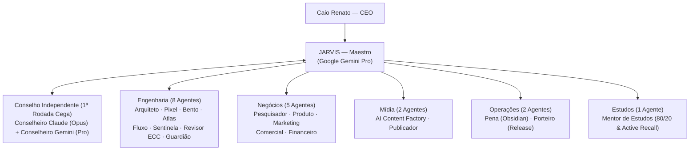

<a id="top"></a>

# Agent Company

> **Arquitetura multiagente com 21 especialistas, 8 Core Skills, estudo ativo 80/20, economia de tokens e governança SQLite *Fail-Closed* (`GPT · Gemini · Claude`).**

[](https://github.com/CaioRen4to/agent-company/actions/workflows/verify.yml)
[](LICENSE)
[](agents/roster.json)
[](#estrutura-e-skills)
[](scripts/security_scan.py)
[](sql/schema-missoes.sql)
[](https://caioren4to.github.io/agent-company/)

[English TL;DR](#english-tldr) · [Como Funciona](#arquitetura) · [21 Agentes](#agentes) · [Conselho Cego](#estudo-caso) · [Segurança 8/8](#seguranca) · [Quickstart](#quickstart) · [Portal Interativo](https://caioren4to.github.io/agent-company/)

---

<a id="english-tldr"></a>
## English Summary (TL;DR)

**Agent Company** is an open-source multi-agent operating architecture for Software & AI Engineers built around **cross-model checks and balances** instead of a single monolithic prompt:
- **21 permanent agents across 7 departments** (`Direction`, `Independent Council`, `Engineering`, `Business`, `Media`, `Operations`, and `Active Study 80/20`).
- **Multi-family routing (`7 OpenAI GPT/Codex · 8 Google Gemini · 6 Anthropic Claude`):** code written by GPT specialists is audited by Claude reviewers (`Revisor ECC` & `Guardião`) to reduce *self-preference bias* (Wataoka et al., 2024; Panickssery et al., 2024).
- **Blind Independent Council (`Fail-Closed`):** critical decisions go simultaneously to two distinct model families (`original request + real diff`) in a blind 1st round; an SQL view (`v_validacao_conselho`) marks any round with fewer than 2 distinct families as `CONSELHO INCOMPLETO`.
- **8-Point Security Scan & Reproducible Audit:** [`scripts/security_scan.py`](scripts/security_scan.py) and [`bench/measure_repo.py`](bench/measure_repo.py) verify skills, CLI safety, and SQLite invariants locally and in GitHub Actions CI.
- **Static Web Explorer:** filter all 21 agents and simulate the SQLite *Fail-Closed* view in [`docs/index.html`](docs/index.html).

> **Suggested GitHub Topics:** `multi-agent-systems` · `ai-agents` · `llm-orchestration` · `claude-code` · `gemini` · `codex` · `sqlite` · `obsidian`

---

<a id="arquitetura"></a>
## 1. Como Funciona (Visão Geral)

Em vez de pedir tudo para um único agente genérico, o **Agent Company** divide o trabalho como uma empresa enxuta:

1. **Um ponto de entrada (`JARVIS — Maestro`):** recebe o pedido, consulta o contexto mínimo e delega em um pacote claro de 5 itens (objetivo, diretório/revisão, restrições, arquivos permitidos e critérios de aceite).
2. **Camadas isoladas na engenharia:** `Pixel` só altera Frontend; `Bento` só altera Backend; `Atlas` só altera SQL/Dados; `Fluxo` só altera Automações. Retrabalho é travado em no máximo **2 ciclos**.
3. **Revisão cruzada e Conselho Cego (*Fail-Closed*):** decisões críticas passam por dois modelos de famílias diferentes (`Claude` × `Gemini`) sem que um veja a resposta do outro. No SQLite, a view `v_validacao_conselho` bloqueia como **`CONSELHO INCOMPLETO`** qualquer rodada com 0 ou 1 parecer.



> [!IMPORTANT]
> **Trava de Segurança:** nenhum agente executa `git push`, deploy, postagem pública, envio de mensagens ou pagamentos sem aprovação explícita do usuário/CEO vinculada à versão avaliada.

---

<a id="multi-familia"></a>
## 2. Roteamento Multi-Família (`7 GPT · 8 Gemini · 6 Claude`)

Cada agente roda na família de modelo mais adequada ao seu trabalho, garantindo independência entre quem constrói e quem audita:

- **Construção de Backend, SQL, Automações e Testes (`Arquiteto`, `Bento`, `Atlas`, `Fluxo`, `Sentinela`):** **OpenAI GPT / Codex**.
- **Auditoria Cruzada de Código e Segurança (`Revisor ECC` e `Guardião`):** **Anthropic Claude (`Sonnet`)** — família distinta de quem implementou Backend, SQL e Automações.
- **Frontend (`Pixel`):** **Anthropic Claude (`Sonnet`)** — para UI crítica ou segurança *client-side*, o Maestro aciona `Sentinela` (`GPT/Codex`) ou o `Conselho Independente` (`Claude` × `Gemini`).
- **Orquestração, Pesquisa, Memória, Mídia/Copy e Ensino 80/20 (`JARVIS`, `Pesquisador`, `Marketing`, `Comercial`, `Publicador`, `Pena`, `Mentor de Estudos`):** **Google Gemini (`Pro / Flash`)**.

> [!TIP]
> **Economia máxima de tokens (janela de 5 horas):** veja [`docs/stack-plugins-mcps-economia.md`](docs/stack-plugins-mcps-economia.md) e os templates em [`configs/`](configs/) para combinar `Context Mode` (FTS5/BM25 em sandbox), `Ponytail` (diffs mínimos), `Graphify` (grafo de código) e `obsidian-triagem` (leitura seletiva).

---

<a id="agentes"></a>
## 3. Os 21 Agentes Permanentes

| Departamento | Qtd | Agentes | Escopo Principal |
|---|---:|---|---|
| **Direção** | 1 | `JARVIS (Maestro)` | Recebe a missão, delega em 5 itens, limita retrabalho a 2 ciclos e consolida evidências. |
| **Conselho** | 2 | `Conselheiro Claude`, `Conselheiro Gemini` | Pareceres cegos independentes (`pedido original + diff real`), somente leitura. |
| **Engenharia** | 8 | `Arquiteto`, `Pixel`, `Bento`, `Atlas`, `Fluxo`, `Sentinela`, `Revisor ECC`, `Guardião` | Planejamento, código isolado por camada, testes e auditoria cruzada AppSec. |
| **Negócios** | 5 | `Pesquisador`, `Produto e Negócios`, `Marketing`, `Comercial`, `Financeiro` | Documentação oficial, PRD, copy, propostas e ROI (sem envios/gastos autônomos). |
| **Mídia** | 2 | `AI Content Factory`, `Publicador` | Pipeline local de vídeo 3D narrado e agendamento sob confirmação do CEO. |
| **Operações** | 2 | `Pena`, `Porteiro` | Memória auditável no Obsidian com *read-back* + checks finais de release. |
| **Estudos** | 1 | `Mentor de Estudos` | Revisão didática de código, síntese 80/20 de vídeos longos e *Active Recall*. |

<details>
<summary><b>Ver lista completa dos 21 agentes (família, papéis consolidados e limite de escrita)</b></summary>

| # | Departamento | Agente | Família / Tier Público | Papéis Consolidados | Responsabilidade e Limite de Escrita |
|---|---|---|---|---|---|
| 1 | **Direção** | **JARVIS (Maestro)** | Google Gemini (`Pro`) | `maestro` | Ponto de entrada do CEO; delega por pacote de 5 itens, limita retrabalho a 2 ciclos e sintetiza evidências. |
| 2 | **Conselho** | **Conselheiro Claude** | Anthropic Claude (`Opus`) | Conselho Independente | 1º parecer cego independente sobre arquitetura, segurança e contratos. Somente leitura. |
| 3 | **Conselho** | **Conselheiro Gemini** | Google Gemini (`Pro`) | Conselho Independente | 2º parecer cego independente de família distinta para expor riscos exclusivos. Somente leitura. |
| 4 | **Engenharia** | **Arquiteto** | OpenAI GPT / Codex (`Systems`) | `planner` + `architect` | Converte requisitos em plano verificável, dependências por arquivo e critérios de aceite. |
| 5 | **Engenharia** | **Pixel** | Anthropic Claude (`Sonnet`) | `pixel` + `a11y-architect` + `react-build-resolver` | Exclusivo Frontend: React/Vite/PWA, CSS, responsividade e acessibilidade. |
| 6 | **Engenharia** | **Bento** | OpenAI GPT / Codex (`Coding`) | `bento` + `build-error-resolver` + `refactor-cleaner` + `performance-optimizer` | Exclusivo Backend: Python/Flask/FastAPI, regras de negócio, auth JWT e build. |
| 7 | **Engenharia** | **Atlas** | OpenAI GPT / Codex (`Structured Data`) | `atlas` | Exclusivo Dados: modelagem PostgreSQL/SQLite, índices, RLS e migrações com rollback. |
| 8 | **Engenharia** | **Fluxo** | OpenAI GPT / Codex (`Coding`) | `agente-automacao` | Exclusivo Automações: workflows, webhooks com idempotência, timeout e retry. |
| 9 | **Engenharia** | **Sentinela** | OpenAI GPT / Codex (`Testing`) | `sentinela` + `tdd-guide` + `e2e-runner` | Execução de testes unitários, integração e jornadas E2E. |
| 10 | **Engenharia** | **Revisor ECC** | Anthropic Claude (`Sonnet`) | `code/python/fastapi/ts/react/database-reviewer` + `silent-failure-hunter` | Revisão cruzada multistack e caça a falhas silenciosas (arquivo, linha e correção). |
| 11 | **Engenharia** | **Guardião** | Anthropic Claude (`Sonnet`) | `security-reviewer` + `dir-seguranca` | Auditoria defensiva cruzada (AppSec): segredos, auth, permissões e varredura 8/8. |
| 12 | **Negócios** | **Pesquisador** | Google Gemini (`Flash`) | `pesquisador` + `docs-lookup` | Fontes primárias e documentação oficial; separa fatos, inferências e lacunas. |
| 13 | **Negócios** | **Produto e Negócios** | Anthropic Claude (`Sonnet`) | `dir-negocios` | Requisitos de produto (PRD), hipóteses de valor e priorização de escopo. |
| 14 | **Negócios** | **Marketing** | Google Gemini (`Pro`) | `dir-marketing` + `copywriter` + `trafego` | Posicionamento, copy e plano de tráfego (sem publicar nem contratar mídia). |
| 15 | **Negócios** | **Comercial** | Google Gemini (`Pro`) | `dir-vendas` + `closer` | Propostas comerciais e scripts de abordagem (nunca envia mensagens sem o CEO). |
| 16 | **Negócios** | **Financeiro** | OpenAI GPT / Codex (`Quantitative`) | `financeiro` | Modelagem de custos, precificação, margem, ROI e orçamento (sem pagamentos). |
| 17 | **Mídia** | **AI Content Factory** | Anthropic Claude (`Opus`) | `pipeline-3d-orchestrator` | Orquestração local de vídeo 3D narrado (GPU local, ex.: RTX 3060, TTS e mixagem). |
| 18 | **Mídia** | **Publicador** | Google Gemini (`Flash`) | `publicador-multi-rede` | Metadados e agendamento em nuvem multi-rede sempre com confirmação do CEO. |
| 19 | **Operações** | **Pena** | Google Gemini (`Flash`) | `pena` + `doc-updater` | Registro auditável no Obsidian (`00-INDICE` a `05-TESTES`) com *read-back* obrigatório. |
| 20 | **Operações** | **Porteiro** | OpenAI GPT / Codex (`Fast CLI`) | `porteiro` | Checks finais de repositório, diffs e pacotes de release (sem `push`/deploy sem CEO). |
| 21 | **Estudos** | **Mentor de Estudos** | Google Gemini (`Pro`) | `mentor-engenharia-ia` + `curador-80-20` | Revisa tarefas de código como mentor, extrai os 20% essenciais de vídeos longos (80/20) e cria perguntas de verificação ativa e exercícios. |

</details>

---

<a id="estudo-caso"></a>
## 4. Conselho Cego (`Claude × Gemini`) & Estudo de Caso Real

1. **Entrada padronizada:** os dois conselheiros recebem o **pedido original do CEO + o `diff` real**, sem ver a opinião do Maestro.
2. **Auditoria cega simultânea:** nenhum modelo lê a resposta do outro na 1ª rodada.
3. **Síntese por divergências + trava SQLite:** o Maestro destaca primeiro onde divergiram ou o que só uma família viu, e a view `v_validacao_conselho` exige 2 famílias distintas.

**Exemplo real no repositório ([`examples/case-study-login-ratelimit/`](examples/case-study-login-ratelimit/)) — proposta de elevar o limite de tentativas de login de 5 para 10:**
- **Convergência (`REPROVA`):** ambas as famílias apontaram falta de escopo do contador (IP vs. conta), janela temporal, política de bloqueio, controles compensatórios (*backoff*/CAPTCHA) e logs/alertas.
- **Exclusivo Claude ([`parecer-claude.md`](examples/case-study-login-ratelimit/parecer-claude.md)):** exigiu checagem contra senhas vazadas (*HIBP*), MFA obrigatório para administradores e testes automatizados.
- **Exclusivo Gemini ([`parecer-gemini.md`](examples/case-study-login-ratelimit/parecer-gemini.md)):** alertou para **Account Lockout DoS** (travamento malicioso de contas de terceiros) sem fluxo seguro de desbloqueio próprio.
- **Trava SQLite ([`seed-case-study.sql`](examples/case-study-login-ratelimit/seed-case-study.sql)):** demonstra `CONSELHO INCOMPLETO` com 1 parecer e `REPROVA` quando as 2 famílias respondem.

---

<a id="seguranca"></a>
## 5. Varredura de Segurança em 8 Pontos & Comparativo

Antes de instalar ou distribuir qualquer skill/script, [`scripts/security_scan.py`](scripts/security_scan.py) verifica automaticamente todo o repositório (localmente e no CI do GitHub):

1. **Estrutura e tipos de arquivo** (sem binários ocultos);
2. **Comandos perigosos** (`shell=True`, `os.system`, `Invoke-Expression`, pipes remotos);
3. **Segredos no código** (`sk-`, `ghp_`, `ghu_`, `AIza`, chaves PEM);
4. **Leitura de variáveis de ambiente** dentro de `skills/` e `scripts/`;
5. **Acesso de rede não declarado** em scripts;
6. **Código ofuscado** (`base64 | sh`, `eval(compile(...))`);
7. **Prompt injection e Unicode oculto** em `SKILL.md`;
8. **Integridade CLI** (trava `--` + validação `http(s)` em `extrair_transcricao.py`).

### Comparativo Técnico

| Capacidade | Agente Único | Skill de Conselho (CLI) | Agent Company (Neste Repo) | Camada Externa Opcional |
|---|:---:|:---:|:---:|:---|
| Delegação em 5 itens + limite de 2 ciclos | — | — | ✓ (`orquestracao-maestro-ecc`) | `OpenBot`, `Claude Code`, `Cursor` |
| Manifesto de 21 papéis com isolamento por camada | — | — | ✓ (`agents/roster.json`) | Perfis do runtime escolhido |
| Revisão cruzada entre famílias (`GPT` × `Claude`) | — | — | ✓ (`Revisor ECC`, `Guardião`) | Provedores `GPT` + `Claude` + `Gemini` |
| Conselho cego + regra *Fail-Closed* (`CONSELHO INCOMPLETO`) | — | ✓ *(sem SQL view)* | ✓ (`sql/schema-missoes.sql`) | `Conselheiro Claude` + `Conselheiro Gemini` |
| Varredura estática de segurança em 8 pontos | — | — | ✓ (`scripts/security_scan.py`) | GitHub Actions CI |
| Portal web para explorar agentes e simular SQLite | — | — | ✓ (`docs/index.html`) | GitHub Pages (`/docs`) |
| Ensino ativo 80/20 para vídeos longos | — | — | ✓ (`mentor-estudo-80-20`) | `yt-dlp` (opcional) |
| Economia de contexto, diffs mínimos e memória auditável | — | — | ✓ (`configs/`, `docs/`, `skills/`) | `Context Mode`, `Ponytail`, `Graphify`, `Obsidian MCP` |

---

<a id="quickstart"></a>
## 6. Quickstart (Copiar e Rodar)

### Pré-requisitos
- **Python 3.9+** (para `init_db.py`, `security_scan.py`, `measure_repo.py` e `extrair_transcricao.py`).
- **`yt-dlp`** (opcional, apenas para baixar legendas públicas de vídeos no fluxo 6.3).
- **SQLite `PRAGMA foreign_keys`:** `scripts/init_db.py` ativa `PRAGMA foreign_keys = ON;`; se abrir `data/missoes.db` em clientes externos, execute esse pragma na sessão.

### 6.1 Inicializar SQLite, rodar Segurança (8/8) e Benchmark
```bash
python scripts/init_db.py --db data/missoes.db --seed
python scripts/security_scan.py
python bench/measure_repo.py
```
*(Idempotente por padrão: preserva missões existentes; passe `--reset` apenas se quiser apagar e recriar o banco.)*

### 6.2 Instalar as 8 Core Skills localmente
```powershell
# Windows (PowerShell)
powershell -ExecutionPolicy Bypass -File scripts/install.ps1
```
```bash
# Linux / macOS (Bash)
bash scripts/install.sh
```
*(Instala por padrão em `~/.claude/skills` preservando pastas existentes; use `-TargetDir` / `-Force` no PowerShell, ou `<pasta>` / `--force` no Bash.)*

### 6.3 Estudo Ativo 80/20 (`Mentor de Estudos`)
```bash
python skills/mentor-estudo-80-20/scripts/extrair_transcricao.py "https://www.youtube.com/watch?v=SEU_VIDEO"
```
Envie a transcrição (ou seu código/tarefa) ao agente **`Mentor de Estudos`** para extrair os **20% essenciais**, gerar **perguntas de verificação ativa** e **exercícios práticos**.

### 6.4 Economia de Tokens & Portal Web
- Guia completo e templates sanitizados: [`docs/stack-plugins-mcps-economia.md`](docs/stack-plugins-mcps-economia.md), [`configs/mcp-servers.example.json`](configs/mcp-servers.example.json) e [`configs/claude-settings.economy.example.json`](configs/claude-settings.economy.example.json).
- Para publicar [`docs/index.html`](docs/index.html) no GitHub Pages: **Settings → Pages → Build and deployment → Source: `Deploy from a branch` → `main` / `/docs`**.

---

<a id="estrutura-e-skills"></a>
## 7. Estrutura do Repositório & Créditos

```text
agent-company/
├── .github/workflows/verify.yml                           # CI automático: security scan + bench + install.sh
├── AGENTS.md                                              # Instruções permanentes do Maestro
├── LICENSE                                                # Licença MIT
├── README.md                                              # Documentação principal
├── THIRD_PARTY_NOTICES.md                                 # Atribuições (ECC, Conselho, Context Mode, Ponytail, etc.)
├── agents/
│   ├── roster.json                                        # Manifesto dos 21 agentes em 7 departamentos
│   └── prompts-especialistas.md                           # Briefings reutilizáveis dos 21 papéis
├── bench/
│   └── measure_repo.py                                    # Auditoria reproduzível de skills, roster, SQLite e segurança
├── configs/
│   ├── claude-settings.economy.example.json               # Perfil econômico para Claude Code (janela 5h)
│   └── mcp-servers.example.json                           # Templates sanitizados de MCPs por departamento
├── docs/
│   ├── index.html                                         # Portal interativo estático (GitHub Pages /docs)
│   └── stack-plugins-mcps-economia.md                     # Guia completo de economia de tokens, plugins e MCPs
├── examples/
│   └── case-study-login-ratelimit/                        # Estudo de caso completo + seed Fail-Closed
├── scripts/
│   ├── init_db.py                                         # Inicializador e verificador SQLite
│   ├── security_scan.py                                   # Varredura estática de segurança em 8 pontos
│   ├── install.ps1                                        # Instalador Windows (8 Core Skills)
│   └── install.sh                                         # Instalador Linux/macOS (8 Core Skills)
├── sql/
│   └── schema-missoes.sql                                 # Schema com FK, CHECK, índices e VIEW v_validacao_conselho
└── skills/
    ├── orquestracao-maestro-ecc/SKILL.md
    ├── conselho-independente-dupla-familia/SKILL.md
    ├── padroes-de-engenharia-ecc/SKILL.md
    ├── revisao-independente-ecc-multistack/SKILL.md
    ├── memoria-auditavel-obsidian-pena/SKILL.md
    ├── obsidian-triagem/SKILL.md
    ├── negocios-pesquisa-e-operacoes-ecc/SKILL.md
    └── mentor-estudo-80-20/
        ├── SKILL.md
        └── scripts/extrair_transcricao.py
```

- **Autor:** [Caio Renato (`@CaioRen4to`)](https://github.com/CaioRen4to)
- **Licenças e Projetos Base:** [`THIRD_PARTY_NOTICES.md`](THIRD_PARTY_NOTICES.md) (**ECC — *Everything Claude Code***).
- **Referências:** Wataoka et al. (2024), *"Self-Preference Bias in LLM-as-a-Judge"*; Panickssery et al. (2024), *"LLM Evaluators Recognize and Favor Their Own Generations"*.

<p align="center">
  <a href="#top">Voltar ao topo ↑</a>
</p>
